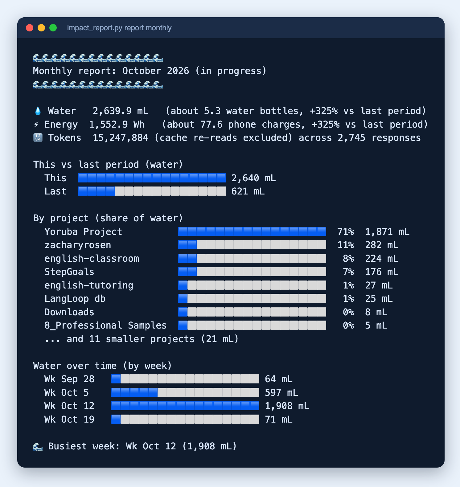

# Environmental Impact Tracker

**v1.5.0**

A Claude Code skill that calculates and displays the environmental footprint of your AI interactions, translating abstract token usage into energy consumption (Wh), water usage (mL), and relatable real-world comparisons.

## What it does

Tracks the energy and water use of **every** Claude response in the background, then turns that history into weekly, monthly, quarterly, and annual reports.



*A monthly report: this period vs last, share of water by project, and water over time. Each figure is computed from the exact token counts of the logged responses.*

Features:
- **Tracks everything**: a Stop hook logs every response, subagents included, so nothing depends on Claude remembering to log it
- **Period reports**: weekly, monthly, quarterly, and annual totals with change vs the previous period, a per-project breakdown, and a trend chart
- **Four modes**: reports only, a line after large responses, both, or off
- **History backfill**: rebuilds past usage from Claude Code's own session transcripts
- **Per-turn display on request**: energy and water for any exchange, with model efficiency comparison and subagent totals (sample below)
- **One shared log**: `~/.claude/environmental-impact-log.json` covers every project

In `per-response` mode the hook prints one line after large responses (more than 5,000 fresh tokens, or any subagent response):

```
🌍 Impact this turn: 5.04 Wh · 8.6 mL · 94,786 tokens · 12 subagent responses
```

Ask Claude for the longer display of any exchange and you get:

```
🌍 Environmental Impact of This Response

Energy: 58.07 Wh (about 3 phone charges)
Water:  98.71 mL (about 6 tablespoons)

Model: Claude Sonnet 5
Tokens: 25,000 in + 6,000 out + ~2,500 skill = 33,500
+ 136,000 agent tokens across 4 agents = 169,500 total

💡 If a lighter model had been used:
  Haiku: 19.36 Wh / 32.90 mL  (3.0x less)

Note: Estimates. See references/sources.md for methodology.
```

## Installation

### Claude Code

Copy this repo's contents (`SKILL.md`, `scripts/`, `references/`) into your Claude Code skills directory:

```
~/.claude/skills/environmental-impact-tracker/
```

Python 3 is required for the hook and the reports.

### Manual (any Claude environment)

Paste the contents of `SKILL.md` into your system prompt or project instructions. Automatic tracking and reports need Claude Code, since they rely on its hooks and session transcripts.

## Setup

Installing the skill alone does not start tracking. Setup is a few one-time steps, and Claude can walk you through them the first time you use the skill:

1. **Pick a mode** (see Modes below). Claude asks and writes your choice to `~/.claude/environmental-impact-tracker.state`. `reports` is recommended.

```bash
echo "reports" > ~/.claude/environmental-impact-tracker.state
```

2. **Add the Stop hook** to `~/.claude/settings.json`, under `hooks.Stop`:

```json
{ "hooks": [ { "type": "command", "command": "python3 -I ~/.claude/skills/environmental-impact-tracker/scripts/impact_hook.py", "timeout": 30 } ] }
```

3. **Backfill your history** once:

```bash
python3 -I ~/.claude/skills/environmental-impact-tracker/scripts/impact_hook.py --backfill
```

This imports every session transcript Claude Code still has. Older transcripts are cleaned up over time, so the log is the only permanent record.

4. **Add this rule to `~/.claude/CLAUDE.md`** so Claude leaves display to the hook:

```markdown
## Environmental Impact
Impact tracking is automatic (a Stop hook logs every response). Do not display impact on your own. When the user asks for an impact report, a total, or to change the tracking mode, use the `environmental-impact-tracker` skill.
```

Already have per-project `.environmental-impact-log.json` files from an older version? Import them with `python3 -I scripts/impact_report.py migrate <project-dir>`. Entries are tagged with the directory name and duplicates are skipped.

## Modes

Tracking always runs unless the mode is `off`. The mode is one word in `~/.claude/environmental-impact-tracker.state`.

| Mode | Tracking | Line after large responses | Reports on request |
|------|----------|----------------------------|--------------------|
| `reports` (recommended) | yes | no | yes |
| `per-response` | yes | yes | yes |
| `both` | yes | yes | yes |
| `off` | no | no | from what is already logged |

Ask Claude to switch ("only reports", "show me after big responses", "turn it off") or edit the file yourself. `both` behaves the same as `per-response`; the legacy value `on` also means `per-response`. A missing state file keeps tracking quietly and Claude asks you to pick a mode. Turning the mode to `off` stops logging as well as display.

## Reports

Ask for a "weekly report", "monthly impact report", "Q3 environmental report", or "last month's footprint", or run the script directly:

```bash
python3 -I ~/.claude/skills/environmental-impact-tracker/scripts/impact_report.py report <weekly|monthly|quarterly|annual> [--back N]
```

`--back N` reports N periods ago, so "last month" is `monthly --back 1`. Weeks run Monday to Sunday; months, quarters, and years are calendar-based (UTC). The current period is marked "in progress", so its comparison to a full previous period can look low.

Each report shows total water and energy with the change vs the previous period, a this-vs-last bar, share of water by project, and water over time by day (weekly), week (monthly), or month (quarterly and annual). The blocks are emoji, so the output renders anywhere text does.

## Usage

Tracking and per-response lines need no prompting; the hook does both. For everything else, be explicit. Testing against fresh Claude instances found that vague phrases like "show me this week's impact" don't reliably trigger the skill, and a phrase echoing the skill's description can get declined if Claude worries a specific Wh/mL figure looks like fabricated precision. What works:

- **Name the period and the word report**: *"Give me my monthly environmental impact report."*
- **Name the skill** if a phrase doesn't land: *"Use the environmental-impact-tracker skill to show my quarterly report."*
- **Or run the script**, which never depends on Claude choosing to act.

## How it works

### Tracking

Claude Code writes the token counts for every response into its session transcripts. `scripts/impact_hook.py` runs as a Stop hook after each response, converts those counts to energy and water with the rates below, and appends one entry per response to the shared log.

- **Per-response math:** the long-context tier is decided by each response's own total tokens, cache reads count at 10% of the input rate, and every response (subagents included) pays the model's fixed overhead.
- **Projects:** a response counts toward its working directory, rolled up to its git repo when it has one.
- **Safe by design:** the hook never blocks a session. On any error it writes to stderr and exits cleanly.

### Energy model

Each query pays a **fixed per-query overhead** (routing/model load, independent of length) plus a **marginal per-token rate**. Long-context turns (>50,000 total tokens) switch to a separate, lower marginal rate. Real-world long-context inference is meaningfully more efficient per token than short chat turns, and a single flat rate can't represent both.

| Model | Fixed overhead (Wh/query) | Marginal Input (Wh/MTok) | Marginal Output (Wh/MTok) | Long-context Marginal Blended (Wh/MTok) |
|-------|------|-------|--------|---------|
| Claude Fable 5 | 0.531 | 270 | 1,341 | 35 |
| Claude Opus 5 | 0.264 | 135 | 669 | 18 |
| Claude Sonnet 5 | 0.159 | 81 | 402 | 11 |
| Claude Haiku 4.5 | 0.054 | 27 | 135 | 4 |

These are **mid-level estimates**. The typical-tier rates are 3x what Joule's optimized-serving data implies, which lands between that derivation and measured Claude benchmarks (about 9 to 13x higher). For a medium prompt (1,000 in / 1,000 out) Sonnet comes out at about 0.64 Wh, against 0.2 Wh from the optimized derivation and 2.78 Wh measured on Claude 3.7 Sonnet. The long-context rate is unchanged. Anthropic publishes no energy figures and no source covers the Claude 5-series, so treat every number as an estimate.

Water usage: 1.7 mL per Wh (average data center cooling + power generation).

The fixed-overhead/marginal-rate split is derived from a peer-reviewed 2026 Joule paper's own test-time-scaling data (a 15x longer query costs only 13x more energy, implying a fixed cost that dilutes with length), anchored to a "medium" query-length definition (1,000 in / 1,000 out) from a companion 2026 benchmarking paper. The long-context rate is anchored separately to a real-world long-context estimate, since extrapolating the short/medium-query rate out to very large contexts overpredicts by roughly 10x. Full derivation and confidence notes: `references/sources.md`.

### Worked example

Using the sample output above: Claude Sonnet 5, 25,000 input + 6,000 output + 2,500 skill-load tokens on the main turn, plus 4 subagents averaging 34,000 tokens each, all under the 50,000-token long-context threshold, so every component uses the typical-tier rates (fixed overhead 0.159 Wh, marginal input 81 Wh/MTok, marginal output 402 Wh/MTok, marginal blended 387 Wh/MTok):

**Main query:**
```
Energy_input  = 25,000 × 81  / 1,000,000 = 2.0250 Wh
Energy_output =  6,000 × 402 / 1,000,000 = 2.4120 Wh
Energy_skill  =  2,500 × 81  / 1,000,000 = 0.2025 Wh
Energy_query  = 0.159 (fixed overhead) + 2.0250 + 2.4120 + 0.2025 = 4.80 Wh
```

**Each subagent** (own fixed overhead, own tier check: 34,000 tokens is under 50,000, so typical-tier blended rate applies):
```
Energy_agent = 0.159 + (34,000 × 387 / 1,000,000) = 0.159 + 13.158 = 13.32 Wh
```
Four subagents: `4 × 13.32 = 53.27 Wh`

**Total:**
```
Total_energy = 4.80 (query) + 53.27 (agents) = 58.07 Wh
Total_water  = 58.07 × 1.7 = 98.7 mL
```

Notice most of the cost here comes from the four subagents, not the main turn. Each one pays its own 0.159 Wh fixed overhead on top of its marginal token cost, which is exactly the behavior the old flat-rate model couldn't represent: spinning up four separate model invocations has a real, distinct cost from one invocation handling four times the tokens.

> **Note:** These are estimates derived from public benchmarks and pricing signals, not official Anthropic energy figures. Actual consumption varies by data center location, cooling method, and grid energy mix.

## Keeping it up to date

This repo is maintained on an ongoing basis, not a one-time drop. Rates are updated whenever a major new Claude model ships or new peer-reviewed research on LLM inference energy/water use is published. See the Update Log in `references/sources.md` for the full history of what changed and why, and follow the instructions there when you do update it.

## Changelog

**1.5.0** (2026-10-19)
- Moved the typical-tier rates to a mid-level estimate (3x the previous optimized-serving values), because measured Claude benchmarks and other published estimates run well above the old figures. The large-context rate is unchanged. Reports now read higher than under 1.4.0, most for short-response work
- Added newer sources to `references/sources.md`: Google's Gemini disclosure, measured Claude 3.7 Sonnet results, and two Claude Code analyses. Anthropic still publishes no figures for any Claude model

**1.4.0** (2026-10-19)
- Tracking is now automatic: a Stop hook logs every response (subagents included) from Claude Code's transcripts, replacing logging that depended on Claude choosing to display impact. Prevents undercounting. 
- Added four modes: `reports`, `per-response`, `both`, `off`. The skill asks for a mode on first use and recommends `reports`
- Added `scripts/impact_hook.py --backfill` to rebuild history from existing transcripts
- Replaced the `CLAUDE.md` display rule with one that leaves display to the hook

**1.3.0** (2026-10-19)
- Added weekly, monthly, quarterly, and annual reports (`scripts/impact_report.py`) with a blue-block visual: this vs last period, share by project, and water over time
- Moved the log to one shared file, `~/.claude/environmental-impact-log.json`, with a `project` field on every entry, plus a `migrate` command for old per-project logs

**1.2.0** (2026-09-03)
- Added an on/off toggle: `~/.claude/environmental-impact-tracker.state` controls automatic firing without uninstalling the skill or editing `CLAUDE.md`
- Added a README Setup section spelling out the `CLAUDE.md` rule and state file explicitly. It was previously only documented inside `SKILL.md`, invisible to anyone browsing the repo

**1.1.0** (2026-09-03)
- Replaced the flat per-token rate model with a fixed-overhead + marginal-rate model, derived from a peer-reviewed 2026 Joule paper's test-time-scaling data
- Added a separate long-context marginal rate for turns over 50,000 tokens (the flat/typical-tier formula overpredicts long-context energy by ~10x)
- Subagents now carry their own fixed overhead instead of being folded into the parent turn's marginal cost
- Relabeled the model table to current-generation models (Fable 5, Opus 5, Sonnet 5, Haiku 4.5)
- Added MIT `LICENSE` file
- Rewrote the Usage section after testing the documented "ask directly" phrases against fresh Claude instances: none of the four autonomously triggered the skill. Usage now documents the reliable path (the `CLAUDE.md` rule) and explains why vague phrasing fails instead of overclaiming it works

**1.0.0** (2026-03-16)
- Initial release

## License

MIT
